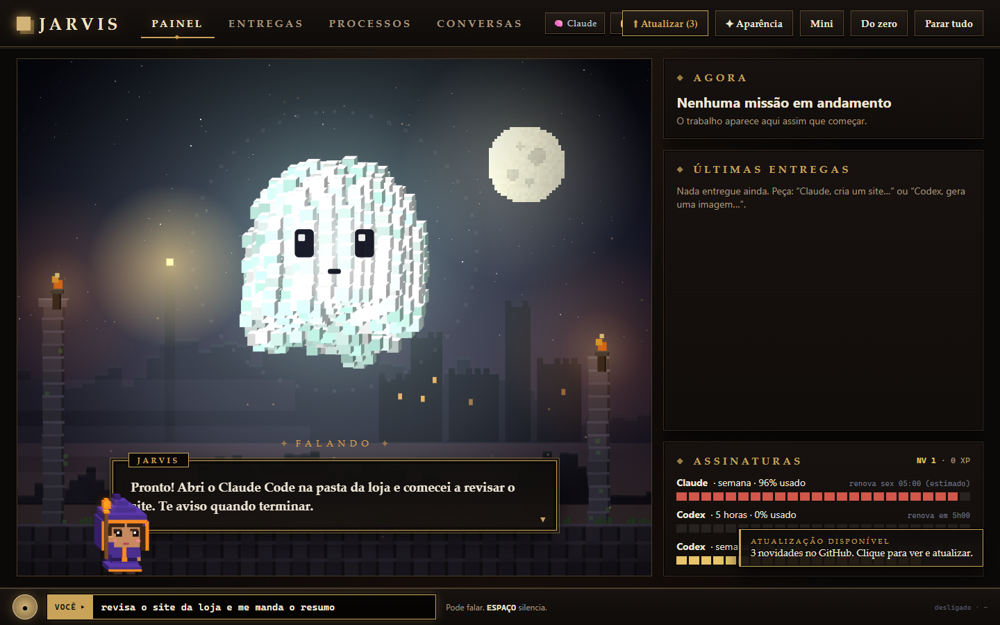
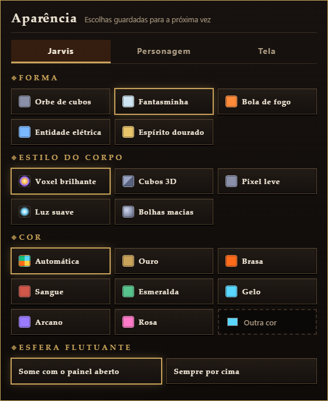
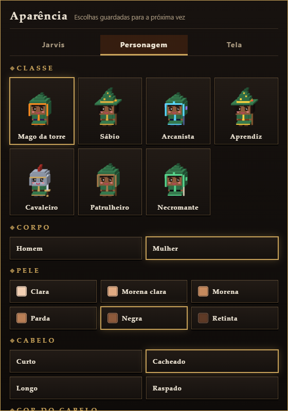

# 🤖 Jarvis

Assistente de voz para Windows, macOS e Linux que conversa com você e põe o **Claude Code** e o **Codex** para trabalhar no seu computador.

Você fala "Jarvis, ...". Ele responde em voz alta, numa frase, abre uma missão para um dos agentes e mostra na tela, ao vivo, o que cada um está fazendo e o que ficou pronto.



- **Voz:** acorda pelo nome, transcreve no seu computador (Whisper) e fala com a voz do Edge.
- **Missões:** cada pedido vira uma missão do Claude Code ou do Codex, numa pasta própria, com as entregas (site, imagem, relatório, vídeo) abertas no painel.
- **Ajuste no meio:** "na 14, é Valinhos, não Campinas" corrige a missão enquanto ela roda.
- **Processos:** roteiros prontos para o que se repete (prospecção, site, pesquisa de mercado, programar num projeto). Dá para criar e editar os seus na tela ou por voz.
- **Projetos e conversas:** "na loja, corrige o botão" trabalha dentro da pasta do projeto; "na conversa 7, pede para continuar" retoma uma conversa do Claude Code.
- **Chat de jogo:** a resposta dele aparece numa caixa de diálogo que se escreve letra a letra, e o pedido por texto vai numa barra fina de chat.
- **Do seu jeito:** 5 formas (orbe, fantasminha, bola de fogo, entidade elétrica, espírito dourado), 5 estilos de corpo, qualquer cor, cenários, temas e um personagem que você monta.
- **Esfera flutuante:** com o painel minimizado, uma esfera pequena fica por cima das outras janelas mostrando o que ele está fazendo, na mesma forma e com o mesmo personagem do painel.
- **Atualiza sozinho:** avisa quando sai versão nova no GitHub e atualiza com um clique.
- **Cérebro local de reserva (opcional):** com o Ollama instalado, ele continua conversando quando a cota do Claude acaba.


Ele usa as **suas** assinaturas (Claude e ChatGPT), pelos programas que já estão instalados e logados no seu computador. Não tem servidor nem conta do Jarvis.

## Do que precisa

| | |
|---|---|
| Windows 10 ou 11, macOS 12 ou mais novo, ou Linux com área de trabalho (Ubuntu, Fedora, Arch...) | obrigatório (o que muda em cada um: "Windows, macOS e Linux", abaixo) |
| Python 3.10 ou mais novo ([python.org](https://www.python.org/downloads/); no Windows, marcando "Add python.exe to PATH") | obrigatório |
| [Claude Code](https://claude.com/claude-code) instalado e com a sua conta | obrigatório: é quem pensa e quem faz a maior parte das missões |
| Codex (da OpenAI) instalado e com a sua conta | opcional: missões de imagem e as que você pedir com "Codex, ..." |
| Microfone | opcional: sem ele, dá para escrever os pedidos no painel |
| Google Chrome, Microsoft Edge ou Chromium | recomendado: o painel abre numa janela própria (sem eles, abre no navegador padrão) |
| Placa NVIDIA (Windows ou Linux) | opcional: a transcrição fica mais rápida e mais precisa (ver "Transcrição na placa") |
| [Ollama](https://ollama.com) | opcional: cérebro local de reserva |
| ffmpeg | opcional: fala sem a janela aberta no Windows/Linux (no macOS já usa o `afplay` nativo) e processo de corte de vídeo |

## Instalar

### Pelo Claude Code ou pelo Codex (mais fácil)

Abra o Claude Code ou o Codex numa pasta onde você guarda programas e cole:

```
Instale o Jarvis deste repositório: https://github.com/edirsooo/jarvis
Clone numa pasta chamada Jarvis, leia o INSTALAR.md e siga o passo a passo de instalação. Meu nome é <seu nome>.
```

A IA clona, instala os pacotes, grava o seu nome, confere o que falta e cria o atalho na área de trabalho.

### Na mão

```
git clone https://github.com/edirsooo/jarvis.git Jarvis
```

```
cd Jarvis
```

```
python instalar.py
```

(No macOS e no Linux, `python3 instalar.py`.) O instalador pergunta o seu nome, instala os pacotes, confere Claude Code, Codex, navegador e microfone e cria o atalho **Jarvis** (área de trabalho no Windows e no macOS, menu de aplicativos no Linux). Pode rodar de novo quando quiser; `python instalar.py --conferir` só mostra o que falta.

### Windows, macOS e Linux

| | Windows | macOS | Linux |
|---|---|---|---|
| Abrir | atalho **Jarvis** ou `Jarvis.vbs` | dois cliques em `Jarvis.command` | menu de aplicativos ou `./jarvis.sh` |
| Ver erros na tela | `Abrir Jarvis (com erros na tela).bat` | `./Jarvis.command --terminal` | `./jarvis.sh --terminal` |
| Abrir junto com o sistema | `Ligar com o Windows.bat` | `python3 instalar.py --ligar-com-o-sistema` (LaunchAgent) | `python3 instalar.py --ligar-com-o-sistema` (`~/.config/autostart`) |
| Pacotes do sistema que o instalador confere | nenhum | PortAudio, ffmpeg e Tk pelo [Homebrew](https://brew.sh), perguntando antes | PortAudio, `python3-tk`, ffmpeg, xdg-utils, wmctrl e xdotool (apt, dnf, pacman ou zypper, perguntando antes do `sudo`) |
| Ícone de bandeja | ao lado do relógio | na barra de menus | na área de notificação (no GNOME, com a extensão AppIndicator) |

O que muda fora do Windows:
- **Voz, missões, painel, processos, projetos, atualização e cérebro local** funcionam igual nos três.
- **Esfera flutuante:** no macOS fica transparente como no Windows; no Linux aparece num quadrado escuro (o Tk do Linux não tem fundo transparente). Fora do Windows, segurar SHIFT não prende a esfera, e o painel minimizado não é detectado: a esfera continua na tela junto com o painel.
- **Trazer o painel para a frente e minimizar:** no macOS o sistema pede permissão de Automação na primeira vez; no Linux precisa do `wmctrl` ou do `xdotool`. Sem eles, o painel só abre (não vem para a frente nem minimiza sozinho).
- **Missões que mexem no computador** (mouse, teclado e capturas, processo "computador"): precisam do `pyautogui` e do `mss` (o instalador põe os dois). No macOS, dê ao Terminal (ou ao Python) as permissões **Gravação de Tela** e **Acessibilidade** em Ajustes do Sistema > Privacidade e Segurança. No Linux funcionam em sessão **X11 (Xorg)** com `xdotool` e `wmctrl`; em sessão **Wayland** ficam desligadas (o sistema não deixa um programa ver a tela nem mexer no mouse de outros) e a missão recebe um aviso claro. Sem como confirmar qual janela está ativa, digitar e apertar teclas é recusado (nada é digitado às cegas).
- **Acender a tela quando ele acorda por palmas:** macOS com `caffeinate`, Linux com `xset` (X11). Em Wayland, não acende.
- **Transcrição na placa:** no macOS não há CUDA, a transcrição usa o processador; no Linux, com placa NVIDIA e CUDA instalada, ele usa a placa sozinho.
- **Cotas na tela:** a do Claude vem do próprio Claude Code em qualquer sistema; a leitura extra do aplicativo do Claude só existe onde ele grava o histórico de uso.
- No macOS, o microfone pede permissão na primeira vez que o Jarvis abre.

## Usar

- Abra pelo atalho **Jarvis** (ou `Jarvis.vbs`; no macOS, `Jarvis.command`; no Linux, `jarvis.sh`). Aparece a janela do painel e um ícone ao lado do relógio (barra de menus no macOS).
- Na primeira vez ele baixa o modelo de transcrição: pode levar alguns minutos até começar a ouvir. O painel mostra o microfone e o modelo de transcrição quando estiver pronto.
- Diga **"Jarvis"** e faça o pedido. Depois de cada resposta ele fica alguns segundos ouvindo sem precisar repetir o nome.
- **"Claude, ..."** manda para o Claude Code; **"Codex, ..."** manda para o Codex. Sem dizer o nome, ele escolhe.
- **"Para tudo"** interrompe as missões. **ESPAÇO** desliga e liga o microfone.
- **"Fica só pelo nome"** quando tiver mais gente na sala. **"Não é contigo"** faz ele dormir na hora.
- Também dá para escrever no campo de baixo do painel.
- "O que diz o relatório das academias?" faz ele ler a entrega da missão e responder em poucas frases.
- **Parar tudo** na tela pede um segundo clique para confirmar; por voz, "para tudo" para na hora.
- Para ver erros na tela: `Abrir Jarvis (com erros na tela).bat` (macOS e Linux: o lançador com `--terminal`). Para abrir junto com o sistema: `Ligar com o Windows.bat` (macOS e Linux: `python3 instalar.py --ligar-com-o-sistema`).
- Fechar de verdade: botão direito no ícone ao lado do relógio, "Fechar o Jarvis".

Exemplos de pedido:
- "Jarvis, faz a prospecção de academias em Londrina."
- "Cria um site de uma página para uma clínica de fisioterapia."
- "Codex, gera uma imagem de um dragão de cubos."
- "Abre o YouTube."
- "Na 3, troca o título para azul."
- "Todo dia às 8 faz o resumo do dia."

## Deixar do seu jeito

Tudo o que é seu fica em arquivos que não vão para o repositório (atualizar com `git pull` não mexe neles):

| Arquivo | Para quê |
|---|---|
| `config.json` | seu nome (`dono`), como ele chama você (`tratamento`), voz, microfone, modelos, tempo de conversa aberta. Os padrões e todas as opções estão em `config.exemplo.json` |
| `memoria\sobre_mim.md` | quem é você e como trabalha, em poucas linhas (modelo em `memoria\sobre_mim.exemplo.md`) |
| `memoria\caderno.md` | o que ele anota quando você diz "anota isso" |
| `modelos\meus\` | os seus processos (criados na aba PROCESSOS ou com "salva isso como processo"). Um seu com o mesmo nome de um que veio pronto vale por cima |
| `dados\`, `missoes\` | histórico, projetos cadastrados, planilhas de leads e as pastas das missões |

Opções úteis do `config.json`:
- `lixeira`: pasta para onde os agentes movem o que não pode ser apagado (eles nunca usam comando de apagar). Sem isso, vai para uma pasta dentro da própria missão.
- `regras_extras`: lista de regras suas que toda missão recebe.
- `pessoas_por_perto`: nomes de quem costuma estar na sala ("tô falando com a Ana" faz ele dormir).
- `whisper_dica`: nomes próprios que você fala muito, para a transcrição acertar.
- `claude_niveis` e `codex_niveis`: qual modelo ou esforço usar em missão leve, média e pesada.

A personalidade (um espírito de poucas palavras que vive no orbe) está em `personalidade.md`.

O botão **✦ Aparência** troca a forma do Jarvis (orbe de cubos, fantasminha, bola de fogo, entidade elétrica, espírito dourado), o cenário do palco (ruínas ao luar, masmorra, floresta sombria, torre arcana), o personagem que anda pelo palco e o tema da tela. Para criar um cenário novo, basta uma entrada em `CENAS` (`web\cenario.js`); uma forma nova, em `FORMAS` e `formaPonto` (`web\app.js`); uma classe nova, em `R` (`web\mago.js`).

O menu tem três abas:
- **Jarvis:** a forma, o estilo do corpo (**Voxel brilhante**, o padrão, um volume de cubinhos de luz; ou cubos 3D, pixel leve, luz suave, bolhas macias), a cor e a esfera flutuante.
- **Personagem:** a classe (mago da torre, sábio, arcanista, aprendiz, cavaleiro, patrulheiro, necromante), homem ou mulher, a pele, o cabelo e a cor dele, a barba, a cor da roupa e o tamanho.
- **Tela:** o tema, a cor de destaque, o cenário e a versão.

O fantasminha e a bola de fogo têm rosto: os olhos seguem o mouse e piscam, ele sorri quando o mouse passa por cima e mexe a boca quando fala. Se o computador estiver pesado, use o estilo **Pixel leve**, que é o mais leve.

<p> </p>

### Atualizar

A cada 6 horas o Jarvis confere no GitHub se saiu versão nova (`git fetch`). Quando sai, aparece o botão **⬆ Atualizar** no topo e um aviso com a lista de novidades. **Atualizar agora** roda `git pull --ff-only` e reinicia o Jarvis sozinho. Se ele estava calado, volta calado. Com missão rodando, ele espera. **Ver no GitHub** abre a lista de mudanças. Para procurar na hora, use **Aparência → Tela → Procurar atualização**. Isso só funciona em cópia clonada pelo git; se você baixou o ZIP, baixe a versão nova pelo GitHub.

### Transcrição na placa

Sem placa NVIDIA, a transcrição usa o processador com o modelo `small`. Com placa (Windows ou Linux), instale o PyTorch com CUDA (ele traz as bibliotecas que a transcrição precisa) e o Jarvis passa a usar o `large-v3-turbo` sozinho:

```
pip install torch --index-url https://download.pytorch.org/whl/cu128
```

## Segurança e privacidade

Leia antes de usar:

- **Os agentes agem no seu computador sem pedir confirmação a cada passo.** As missões do Claude Code rodam com `--permission-mode bypassPermissions` (opção `claude_permissao` do `config.json`) e as do Codex com `workspace-write`. Eles podem criar e alterar arquivos e rodar comandos. Use numa máquina e com contas em que você aceita isso.
- As regras de toda missão proíbem apagar arquivo, enviar e-mail ou mensagem, publicar, comprar e instalar programas, e o Jarvis pede confirmação por voz antes de delegar algo assim. Isso é instrução para a IA, não uma trava técnica.
- O processo "computador" mexe no mouse e no teclado à sua vista. Levar o mouse ao canto de cima à esquerda da tela para na hora (nos três sistemas).
- O servidor só atende no próprio computador (`127.0.0.1`) e recusa pedidos vindos de outros sites abertos no navegador.
- Os sites que as missões entregam abrem isolados no painel: rodam, mas não conseguem falar com o Jarvis (um texto copiado da web num site gerado não vira pedido).
- "Abre tal arquivo" por voz não executa programa nem script (`.exe`, `.bat`, `.ps1`, `.sh`, `.command`, `.app`, `.desktop`, arquivo marcado como executável...): abre a pasta com o arquivo marcado.
- **O que sai do computador:** o texto dos seus pedidos vai para a Anthropic e a OpenAI pelos programas deles (Claude Code e Codex), e o texto que ele fala vai para o serviço de voz do Edge (Microsoft). O áudio do microfone é transcrito no seu computador e não é enviado.
- Cada missão gasta a cota das suas assinaturas. Processo agendado também.

## Testes

A pasta `testes\` roda o Jarvis numa cópia isolada (outra porta, pasta temporária, sem som nem janela) com um Claude Code de mentira, sem gastar cota. Detalhes em `testes\LEIA-ME.md`.

```
python testes\teste_servidor.py
```

`python testes\teste_plataformas.py` simula o macOS e o Linux a partir de qualquer computador (confere que tudo carrega e que cada sistema cai no caminho certo).

## Como é por dentro

| Arquivo | Papel |
|---|---|
| `jarvis.py` | servidor local (aiohttp) que junta tudo e serve o painel |
| `ouvido.py` | microfone, palavra de ativação e transcrição (faster-whisper) |
| `cerebro.py` | quem decide o que falar e o que delegar: Claude Code (Haiku) ou o modelo local do Ollama |
| `agentes.py` | missões: abre e acompanha o Claude Code e o Codex |
| `processos.py`, `modelos\` | roteiros prontos |
| `conversas.py` | projetos cadastrados e conversas numeradas do Claude Code |
| `voz.py` | fala (Edge TTS) |
| `janelas.py`, `mini.py` | janela do painel e esfera flutuante |
| `plataforma.py` | o que muda entre Windows, macOS e Linux (abrir arquivo, navegador, processos, pastas) |
| `ferramentas\` | navegador com capturas, planilha de leads, mouse e teclado (`pc.py`; no macOS e no Linux, com `pc_posix.py`) |
| `web\` | o painel (HTML, CSS e JavaScript puros) |

## Licença

MIT. Feito por [Prestes Design](https://github.com/edirsooo). "Jarvis" aqui é só o nome que o assistente atende; o projeto não tem ligação com a Marvel.
